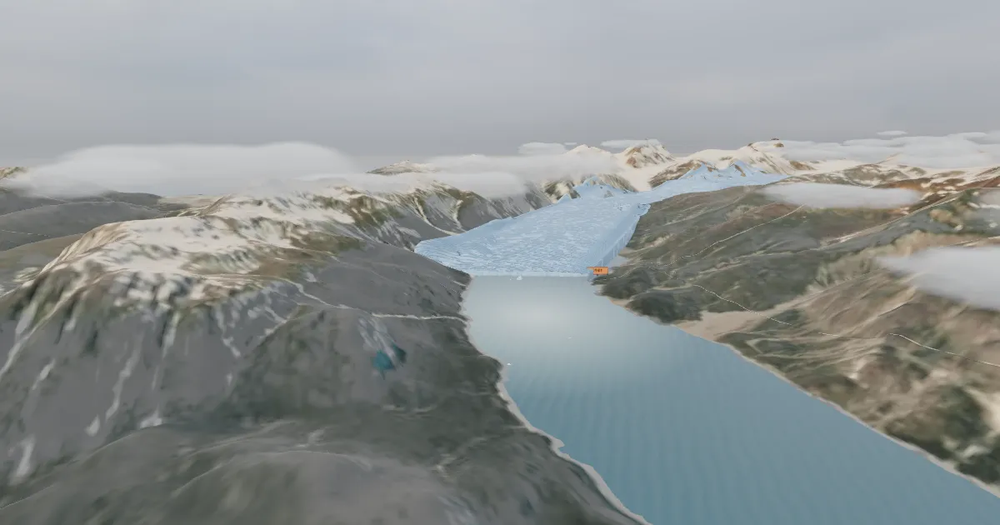

> **Evaluation status (v3.0.0, 2026-11-09):** Automated functional, accessibility and performance testing is complete (headed GPU audit on an Apple M1, unit and browser tests). v3 had no agent design reviews (the owner chose a lean process); earlier versions' agent reviews are in `evaluation/reviews/`. The owner reviewed the v3 scene and approved it on 2026-11-09; that is owner visual approval, not user testing. No real learners have tested this yet. No physical phone testing has been done (mobile was checked with device emulation). Known open issues at v3.0.0 are listed in [STATUS.md](STATUS.md). See `evaluation/METHODS.md`.

# Glacier Time Machine

Explore the real 3D landscape of Muir Inlet, Alaska, compare USGS repeat photographs from 1941, 1950 and 2004, measure distances on the terrain, calculate retreat rates as lower bounds, predict what grows on newly exposed ground, and judge how sure we can be about the causes.

**Play:** https://immersive-learning-showcase.vercel.app/play/glacier-time-machine/

**Trailer:** [docs/trailer.webm](docs/trailer.webm) (58 s, recorded from v2.0.0, so it doesn't show the v3 scene; captioned; WebVTT sidecar at [docs/trailer.vtt](docs/trailer.vtt)).

## v3.0.0: the timeline bar
- **Navigation:** a bottom bar built around the 1941 → today timeline, with the module stepper, one **Go to** menu, **Back** (the previous screen), **Back to start** (the intro) and the menu; the camera buttons sit just above it on touch. Map-style callouts with a leader line to the object. Project pages don't link to other projects.
- **Scene:** crevassed 1941 and 1950 ice with a calving face, séracs and dirt bands (illustrative forms); calving labelled time-lapse; till and ice-smoothed outcrops, boulders and scree on the station ground; pioneer plants on the station till (shown from 2004, the year they grew); clustered forest, soft cloud banks, a kayak you can ride with, survey flags at each dated front.
- **Purposeful interaction:** only course objects (17 task, 7 learn) open cards; seabirds, clouds, the kayak and brash ice open nothing.
- **Performance (headed Chromium on an Apple M1 GPU, Medium, every module state at four viewports):** at most 9.11 ms GPU p95 (budget 12 ms), at least 58 fps, at most 193 draw calls and 0.73 M triangles, 5.21 MB before the first interaction.

## Problem

Students see glacier "before and after" photos often but rarely practise how scientists measure change, how large the uncertainty is, or why one cause is too simple. On a charged topic, a lesson has to be evidence-first.

## Audience

Grades 9–12 earth and environmental science, introductory undergraduate geoscience, adult museum visitors (Modules 1–2 work as a 10-minute path). 45–60 minutes.

## Approach

Five modules, each in the 3D view's task panel and in text mode (same renderer, same decisions):

1. **River of ice:** pre-check, 25 s flyover over the real terrain, how glaciers move (NPS).
2. **Same place, different time:** swipe the 1941 and 2004 USGS photos; tag the changes (with distractors).
3. **Measure it:** time slider over the three dated photos; measure on a valley path computed from the elevation model; compute rates from the published "more than" figures as lower bounds; rate chart plus data table.
4. **What came next:** predict-observe-explain; order the NPS primary-succession stages.
5. **Why, and how sure?:** sort claims from evidence; write a confidence statement; rubric self-check; post-check; transfer to a fictional glacier (constructed for teaching purposes).

## Key design decisions

- **Only verified numbers.** 1941–1950: more than 3 km of retreat and 100 m of thinning. By 2004: more than 7 km northwest. Riggs Glacier: up to 600 m of retreat and more than 250 m of thinning. Retreat began in the mid-1700s. No terminus positions between the dates are shown, because none are verified.
- **Rates are lower bounds.** "At least 0.33 km/yr" (1941–1950) and "at least 0.11 km/yr" (1941–2004), shown with "at least" arrows and no connecting line.
- **Multiple causes.** Pre-1941 retreat, tidewater calving, snowfall and topography alongside climate trends. Both one-cause extremes are marked too strong.
- **Honest labels.** Since v2 the terrain is draped with a 2024 Sentinel-2 image, muted for past years (illustrative); the ice forms are illustrative. The measurement path is a ruler, not a flowline. One USGS file has a date conflict (`Field - 1950` is dated 1941 on its record), so it is flagged in-app and not used.
- Full log: `DECISIONS.md`. Plan deviations (no 3D photo alignment, no dated terminus history) are in `STATUS.md`.

## Realism rationale

The terrain is real (Copernicus GLO-30 at true scale) because the place, its scale and the viewpoint are the evidence. Decorative detail (waves, wildlife, boats) is left out during tasks. See `design/realism-matrix.md`.

## Evidence and evaluation

v3.0.0, run by the builder: 141 unit tests and 14 browser tests pass (axe with zero critical/serious issues, sub-path build, the bar and timeline, keyboard-only Modules 1–5, text mode, reduced motion, touch, no-WebGL, plants and object roles), plus the headed GPU audit above. Agent design reviews covered v1 and v2 (`evaluation/reviews/`); v3 had none, by the owner's lean process. No learner data exists. See `evaluation/METHODS.md` and `design/data-measurement-validation.md`.

## Accessibility

Full text mode, keyboard-operable slider, measurement, sorting and ordering (no drag and drop), alt text on every photo, chart with data table, captioned and skippable cinematics with reduced-motion stills. See `design/accessibility-plan.md`.

## Data credits

- Terrain: produced using Copernicus WorldDEM-30 © DLR e.V. 2010-2014 and © Airbus Defence and Space GmbH 2014-2018 provided under COPERNICUS by the European Union and ESA; all rights reserved.
- Photographs: W. O. Field (1941, 1950) and Bruce F. Molnia (2004), USGS, public domain.
- Facts: USGS photo records, NPS Glacier Bay pages, NGSS (see `research/sources.md`).
- Sky: Kloofendal Overcast (Pure Sky) by Greg Zaal, Poly Haven, CC0.
- Full list: `ATTRIBUTION.md` and `public/attribution.json`.

## Next steps

Camera solve and a 3D photo overlay; keyless imagery per date; a verified terminus history; sources for fjord depth, calving and regional climate; real learner testing.

## Tools

three.js 0.186.1, Vite 8.3.5, Playwright 1.64.1, axe-core, vitest, GDAL 3.13.3 (data pipeline).

## Authorship

AI-assisted: built by an AI coding agent working from a human-written plan, with every fact checked against a source opened and logged in `research/`. The owner reviewed and approved the v3 scene visually on 2026-11-09 (not user testing).

## License

Code MIT (`LICENSE`), content CC BY 4.0 (`LICENSE-CONTENT`). Third-party assets keep their own licences (`ATTRIBUTION.md`).
